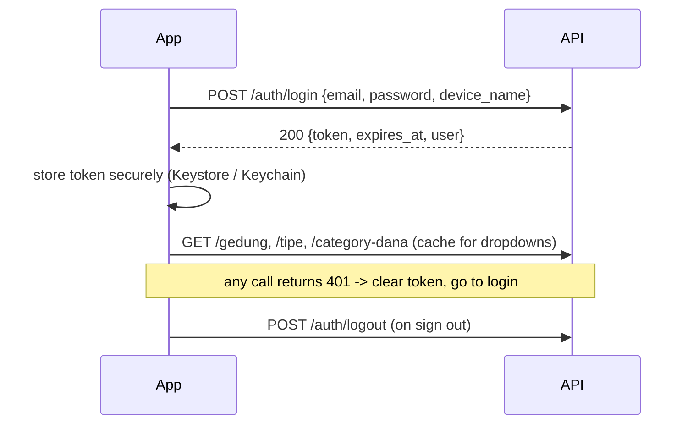
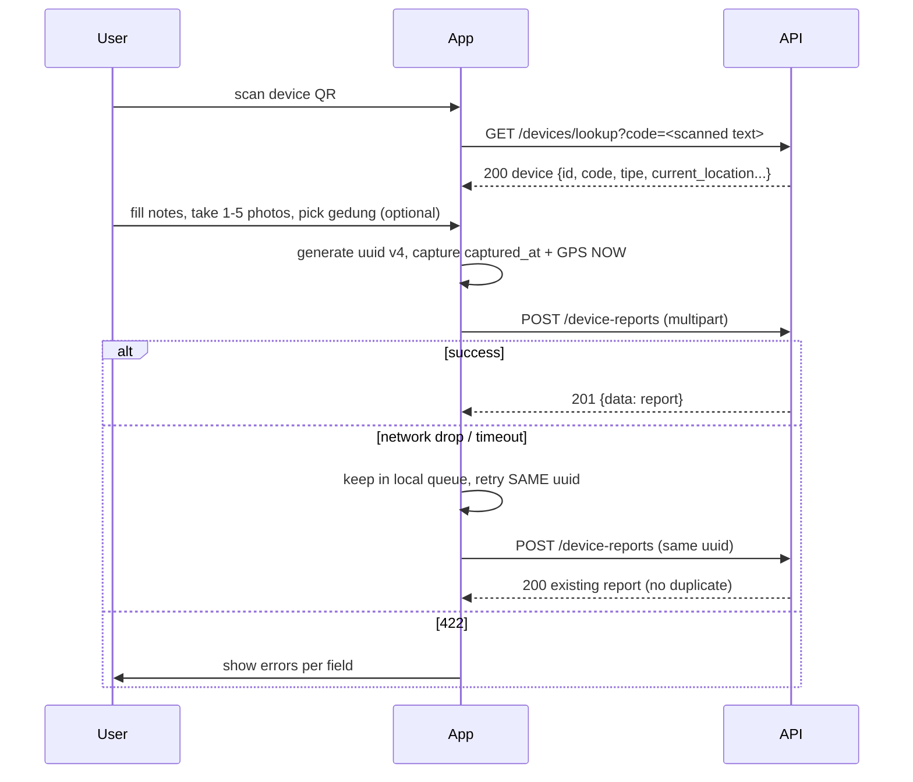

# PustikomWeb Mobile API (v1) — Device Report

Audience: mobile developers. Describes the API and the app flow for creating device reports (datetime, GPS coordinates, notes, photos).

Status: implemented on the backend, derived from the code in `routes/api.php` and `app/Http/Controllers/Api/V1`. It has **not** been exercised end-to-end against a running server yet — verify against a real environment (see the checklist at the end) and report any mismatch.

## 1. Basics

| Item | Value |
|---|---|
| Base URL | `{APP_URL}/api/v1` (e.g. `https://sipp.tik.ung.ac.id/api/v1`) |
| Format | JSON. Uploads use `multipart/form-data`. |
| Auth | `Authorization: Bearer <token>` (Laravel Sanctum) on everything except login |
| Headers | Always send `Accept: application/json`. (The server forces JSON for `/api/v1`, but send it anyway.) |
| Who can log in | Any existing web `User` (email + password), any role |
| Language of messages | Indonesian |
| Time format | ISO 8601 with offset, e.g. `2026-11-15T09:30:00+08:00` |

Roles: every authenticated user can create reports. A user with role `user` only sees and edits **their own** reports. A user with role `admin` sees and edits **all** reports.

### Common response shapes

| Status | Meaning | Body |
|---|---|---|
| 200 / 201 | OK / created | resource (see below) |
| 204 | OK, no content | empty |
| 401 | Missing/invalid/expired token | `{"message":"Unauthenticated."}` |
| 403 | Not owner/admin | `{"message":"This action is unauthorized."}` |
| 404 | Not found (also for unknown routes) | `{"message":"Data tidak ditemukan."}` |
| 409 | `uuid` already used by another user | `{"message":"UUID sudah digunakan."}` |
| 413 | Request body too large (server limit) | server-dependent, may not be JSON |
| 422 | Validation failed | `{"message":"...","errors":{"field":["message"]}}` |
| 429 | Login throttled (5 attempts/min per email+IP) | `{"message":"Too Many Attempts."}` |

Single resources are wrapped: `{ "data": { ... } }`. Lists are paginated: `{ "data": [...], "links": {...}, "meta": {"current_page","last_page","per_page","total",...} }`. Reference lists (gedung/tipe/category-dana) are **not** paginated but still wrapped in `data`.

## 2. App flow

### 2.1 Login and session


### 2.2 Create a report (scan QR → report)


### 2.3 Rules the app must follow
1. **Generate the `uuid` (v4) once, when the user starts the report, and reuse it for every retry.** The server returns the existing report (200) if the same user repeats it. A different user sending the same uuid gets 409.
2. **`device_id` in report calls is the numeric `devices.id`** from the device resource (`data.id`), **not** the QR/`code` string.
3. **`captured_at` is the time the observation happened** (device clock, with timezone offset), not the upload time. It must not be in the future — if the phone clock runs ahead of the server the call fails with 422, so keep the phone on automatic time.
4. **`latitude` and `longitude` go together** (both or neither). Ranges: -90..90 and -180..180.
5. **Photos:** 1–5 per report, each ≤ 5 MB, formats `jpg`, `jpeg`, `png`, `webp` only. **HEIC is rejected** — convert/compress to JPEG before upload. Field name is `images[]` (repeat per file).
6. Uploading 5 photos can be up to 25 MB. Compress on device (e.g. long side ~1920 px, quality ~80) and show upload progress.
7. Handle 413 (server body-size limit) and show a clear message.
8. Treat **404 on DELETE** as success (already deleted).

## 3. Endpoints

### 3.1 Auth

#### `POST /auth/login`
Request (JSON):
```json
{ "email": "user@example.com", "password": "secret", "device_name": "Pixel 7" }
```
- `device_name` is required (max 100). Logging in again with the same `device_name` replaces the previous token for that name (one active token per device name).

200:
```json
{
  "token": "1|abcdef...",
  "token_type": "Bearer",
  "expires_at": "2026-12-15T10:00:00+08:00",
  "user": { "id": 3, "name": "Budi", "email": "user@example.com", "role": "user" }
}
```
- `expires_at` is `null` when the server has no expiry configured. When set, re-login after it passes (a 401 means the same).
- 422 `{"errors":{"email":["Email atau password salah."]}}` for bad credentials.

#### `POST /auth/logout` (auth) → 204
Deletes the current token.

#### `GET /auth/me` (auth) → 200
```json
{ "data": { "id": 3, "name": "Budi", "email": "user@example.com", "role": "user" } }
```

### 3.2 Devices (read-only)

Device resource:
```json
{
  "id": 12,
  "code": "ABC123",
  "is_active": true,
  "tipe": { "id": 1, "name": "Access Point", "slug": "access-point" },
  "category_dana": { "id": 2, "name": "BMN" },
  "sticker_url": "https://host/storage/uploads/sticker/xxx.png",
  "current_location": {
    "gedung": { "id": 5, "name": "Kuliah 1", "lokasi": "...", "label": "...", "parent_id": null, "photo_url": null },
    "location": "50.00,25.00",
    "since": "2026-10-01T08:00:00+08:00"
  }
}
```
`current_location` is `null` when the device has no location history. `code` is the public device code printed on the sticker.

#### `GET /devices/lookup?code=<text>` → 200 `{ "data": <device> }` / 404
Pass the **raw scanned QR text**. The server accepts a bare code (`ABC123`), a URL with slash (`https://sipp.tik.ung.ac.id/device/ABC123`), and the older printed form without a slash (`https://sipp.tik.ung.ac.id/deviceABC123`). Use `data.id` for report calls.

#### `GET /devices` → paginated list
Query (all optional): `search` (matches code), `tipe_id`, `category_dana_id`, `is_active` (`true|false|1|0`), `per_page` (1–100, default 15), `page`.

#### `GET /devices/{id}` → 200 `{ "data": <device> }` / 404
`{id}` is the numeric `devices.id`.

### 3.3 Reference lists (cache these for dropdowns)

| Endpoint | Item shape |
|---|---|
| `GET /gedung` | `{ id, name, lokasi, label, parent_id, photo_url }` — flat list, build the tree with `parent_id`; show `label` in pickers |
| `GET /tipe` | `{ id, name, slug }` |
| `GET /category-dana` | `{ id, name, slug }` |

All return `{ "data": [ ... ] }`.

### 3.4 Device reports

Report resource:
```json
{
  "id": 7,
  "uuid": "2f1c1f3e-8f0e-4c53-9a3b-1f2d3c4b5a69",
  "device_id": 12,
  "gedung_id": 5,
  "captured_at": "2026-11-15T09:30:00+08:00",
  "latitude": 0.5412345,
  "longitude": 123.0612345,
  "notes": "Kabel LAN longgar",
  "created_at": "2026-11-15T09:31:10+08:00",
  "updated_at": "2026-11-15T09:31:10+08:00",
  "device": { "id": 12, "code": "ABC123" },
  "gedung": { "id": 5, "name": "Kuliah 1", "label": "..." },
  "user": { "id": 3, "name": "Budi" },
  "images": [ { "id": 1, "url": "https://host/storage/uploads/device-report/2026/11/xxx.jpg", "sort": 0 } ]
}
```
`latitude`, `longitude`, `gedung`, `user` can be `null`. Timestamps are shown in the **server's timezone** offset.

#### `POST /device-reports` — create (multipart/form-data)

| Field | Required | Rule |
|---|---|---|
| `uuid` | yes | UUID, client generated |
| `device_id` | yes | integer, `devices.id` |
| `captured_at` | yes | date/ISO 8601, not in the future |
| `gedung_id` | no | integer, existing gedung |
| `latitude` | no | -90..90, required if `longitude` sent |
| `longitude` | no | -180..180, required if `latitude` sent |
| `notes` | no | text, max 2000 chars |
| `images[]` | yes | 1–5 files, jpg/jpeg/png/webp, ≤ 5 MB each |

- 201 `{ "data": <report> }` when created.
- 200 `{ "data": <report> }` when the same user repeats an existing `uuid` (nothing is created or re-uploaded).
- 409 when another user already used the `uuid`.
- 422 with per-field errors; image errors are keyed `images` or `images.0`, `images.1`, ...

Example:
```bash
curl -X POST "$BASE/api/v1/device-reports" \
  -H "Authorization: Bearer $TOKEN" -H "Accept: application/json" \
  -F "uuid=2f1c1f3e-8f0e-4c53-9a3b-1f2d3c4b5a69" \
  -F "device_id=12" \
  -F "captured_at=2026-11-15T09:30:00+08:00" \
  -F "gedung_id=5" \
  -F "latitude=0.5412345" -F "longitude=123.0612345" \
  -F "notes=Kabel LAN longgar" \
  -F "images[]=@photo1.jpg" -F "images[]=@photo2.jpg"
```

#### `GET /device-reports` — list (paginated)
Own reports (admin: all), newest `captured_at` first.
Query (optional): `device_id`, `gedung_id` (includes child buildings), `user_id` (admin only; ignored otherwise), `from`, `to` (dates on `captured_at`, inclusive), `q` (notes or device code), `per_page` (1–100, default 15), `page`.

#### `GET /device-reports/{id}` → 200 `{ "data": <report> }`
403 if the report belongs to someone else (non-admin).

#### `PUT|PATCH /device-reports/{id}` — update fields (JSON, no files)
Send any of: `captured_at`, `gedung_id`, `latitude`, `longitude`, `notes`. To clear coordinates send **both** as `null`; to clear the building send `gedung_id: null`. Returns 200 `{ "data": <report> }`. Photos are changed through the image endpoints below.
Note: the code also accepts `device_id` on update (it is not blocked). Do not send it unless you intend to move the report to another device.

#### `DELETE /device-reports/{id}` → 204
Deletes the report and its photo files.

#### `POST /device-reports/{id}/images` — add photos (multipart)
Field `images[]`, 1–5 files; the total after adding must be ≤ 5 (otherwise 422 on `images`). Returns 201 `{ "data": [ {id, url, sort}, ... ] }` (only the newly added images).

#### `DELETE /device-reports/{id}/images/{imageId}` → 204
- 422 `{"errors":{"image":["Laporan minimal harus memiliki 1 foto."]}}` if it is the last photo.
- 404 if `imageId` does not belong to this report.

## 4. Offline / retry guidance
- Keep a local queue of unsent reports: `{uuid, device_id, captured_at, lat, lng, notes, gedung_id, image file paths}`.
- Retry with the same `uuid` on network errors, timeouts and 5xx. Stop retrying and surface the error on 401 (re-login, then retry), 409, and 422 (needs user fix; for a future `captured_at` fix the clock or re-capture).
- Treat 200 and 201 from `POST /device-reports` both as "synced".
- Mark a queued item done only after 200/201; delete local photos after that.
- Do not overwrite `captured_at` with the upload time.

## 5. Checklist for the mobile team (check before implementing)
- [ ] Login works with a normal web user; token stored securely; 401 handling returns to login.
- [ ] `device_name` is sent (device model or a stable id).
- [ ] QR scan → `GET /devices/lookup?code=` works for stickers already printed (the older no-slash form).
- [ ] Report uses `device.data.id`, not `code`.
- [ ] `uuid` generated once per report and reused on retry; retry returns 200 without duplicates.
- [ ] `captured_at` sent with timezone offset; check for a clock-skew 422 on a real phone.
- [ ] Photos converted to JPEG (no HEIC), ≤ 5 MB each, max 5, sent as repeated `images[]`.
- [ ] Image `url` values load on the device (needs `php artisan storage:link` and correct `APP_URL` on the server).
- [ ] Large upload (5 × 5 MB) succeeds against the real server (PHP `post_max_size`/`upload_max_filesize` ≥ 30M, nginx `client_max_body_size`).
- [ ] Non-admin user cannot see another user's report (403/absent in list).
- [ ] Pagination handled (`meta.last_page`).

## 6. Backend setup required (server owners)
1. `php artisan migrate` (creates `device_reports`, `device_report_images`).
2. `php artisan storage:link`; set a correct `APP_URL`.
3. Optional token lifetime: `SANCTUM_EXPIRATION=<minutes>` in `.env` (e.g. `43200` = 30 days). It also applies to legacy tokens.
4. Raise PHP/nginx upload limits (see checklist).

## 7. Legacy endpoints (do not use for the new app)
`POST /api/login` (plain-text token, no expiry) and `GET /api/user` remain unchanged for backward compatibility. The mobile app should use `/api/v1/auth/*`.
